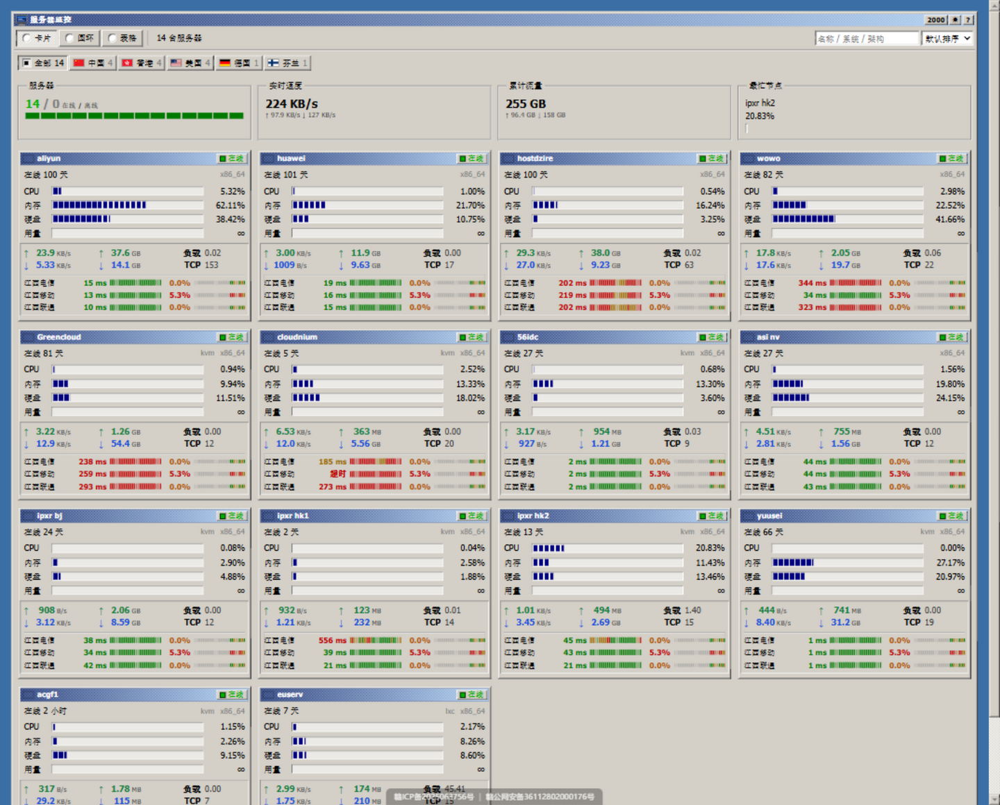

# Nezha 面板主题 · Windows 2000

把哪吒监控（[nezhahq/nezha](https://github.com/nezhahq/nezha)）的公开前台做成一扇 Windows 2000 的窗口：
灰色立体控件、蓝色渐变标题栏（带 50% 抖动网点）、分段 LED 进度条、宋体小字、状态栏右下角一句 Powered by Nezha。
四套皮肤、深浅两套配色、三种视图。



---

## 特性

**外观**

- 四套皮肤：**Windows 2000**（默认）、**Windows 3.1**、**Windows XP (Luna)**、**Mac OS X 10.6 (Aqua)**，右上角切换
- 深浅两套配色，另有「跟随系统」；皮肤与配色都记在浏览器里，切换时不会闪一下旧样式
- 细节照旧系统：凸/凹两级斜面边框、按下态用网点填充、滚动条带抖动轨道与三角箭头、浅黄提示条、Aqua 皮肤换成红黄绿三个圆点和居中的标题

**数据**

- **卡片视图**：整张卡片是一个链接（中键/新标签页打开详情页）；标题栏放国旗、系统图标、名称、在线状态（离线卡片标题栏变灰，从未上报的显示「未接入」）；下面是 CPU / 内存 / 硬盘 / 流量配额的分段进度条（无配额显示 ∞）；再下面是上下行速率、累计流量（有配额规则时悬停显示本周期用量）、剩余天数与价格（`金额 / 周期`，悬停显示「续费 …」）；底部是该机的服务监控
- **OS 图标**：卡片标题栏、表格、详情页按 `host.platform` 显示品牌色系统图标（Ubuntu 橙、Debian 红、Windows 蓝……），内置 20+ 平台，未知的回退到通用标记
- **服务监控行**：最新时延按数值分级着色（<100ms 绿 / <200ms 黄 / 其余红，失败显示红色「超时」）；粗色条是最近 1 天每个采样桶的往返时延（同色阶），细色条是 30 天内每天的丢包比例（0% 绿 / <5% 黄 / 其余红）
- **圆环视图**：CPU / 内存 / 硬盘 三只伪立体圆柱表（用 conic-gradient 画的）
- **表格视图**：经典 listview，表头是凸起的列头，行悬停是深蓝选中色，CPU/内存/硬盘带行内迷你条
- **监控页面** `/server/<id>`：工具条带时间范围按钮组（1 天 / 7 天 / 30 天，游客只有 1 天）与采样点数；主机信息含价格、剩余、本周期流量、累计流量与温度；下面是 CPU / 内存 / 硬盘三条全宽仪表、四张带面积填充的黑底绿线图表（CPU / 内存 / 网络双向 / 负载），以及一张**网络延迟多线图**——每个探测一条线（配色轮换），图例标出各探测的丢包率
- **汇总栏**：在线/离线（附整机队形色条）、实时速度、累计流量、最忙节点
- **筛选**：按国家（显示中文国名，超过 8 个收进「更多」菜单）、按名称/系统/架构搜索、六种排序
- **计费周期**：月 / 季 / 半年 / 年 / 两年 / 三年 / 一次性，`autoRenewal` 过期自动滚周期，`0000-00-00` 视为永不过期（显示 ∞）

**工程**

- 没有依赖、没有构建步骤：纯 HTML + CSS + 原生 JS，面板按静态文件直接发
- 中英文跟随面板的 `language` 设置
- 窄屏自适应：单列卡片、表格横向滚动、次要汇总框隐藏
- 2 秒一帧的推送用**原地更新**（只改文本和条宽），不重建 DOM——菜单不会被刷掉，进度条也不闪

---

## 安装

### 方式一：放进面板工作目录（不用重新编译，推荐）

面板取模板文件时**先看进程工作目录下的同名目录**，找不到才用二进制里内嵌的那份。官方安装脚本的工作目录是 `/opt/nezha/dashboard/`，而 `user_template` 默认就是 `user-dist`，所以把本主题放进去即可：

```bash
# 确认工作目录（应当输出 /opt/nezha/dashboard/）
systemctl cat nezha-dashboard | grep WorkingDirectory

cd nezha-theme-win2000
sudo cp -r dist /opt/nezha/dashboard/user-dist          # 若该目录已存在，先备份
sudo systemctl restart nezha-dashboard
```

打开面板首页，强刷一下（Ctrl+F5）就能看到。想退回官方前台：删掉 `/opt/nezha/dashboard/user-dist` 再重启。

Docker 安装的话，把文件拷进容器的 `/dashboard/user-dist/` 再重启容器；容器重建会丢，建议把该目录挂成卷：

```bash
docker cp dist/. nezha-dashboard:/dashboard/user-dist/
docker restart nezha-dashboard
```

### 方式二：自己编译 / 做成发行版

- 自编译：把 `dist/` 里的东西放进 `cmd/dashboard/user-dist/`，`//go:embed *-dist` 会一并打进二进制，`go build` 即可
- 做成可安装的前台模板（release 方式）：

  ```bash
  bash build.sh v1.0.0        # 生成 dist.zip（顶层就是 dist/ 目录）
  gh release create v1.0.0 dist.zip --title v1.0.0
  ```

  然后在面板源码 `service/singleton/frontend-templates.yaml` 里加一条，重新编译：

  ```yaml
  - path: "win2000-dist"
    name: "Win2000"
    repository: "https://github.com/Lzq2190/nezha-theme-win2000"
    author: "Lzq2190"
    version: "v1.0.0"
  ```

  ⚠️ `user_template` 只在**这份内置列表**里取值，写不在列表里的 path 会被静默改回 `user-dist`。所以自定义 path 必须重新编译面板；不想编译就用方式一。

### 方式三：本机预览（不需要真面板）

仓库自带一个假面板，接口和 WebSocket 都按真面板的格式返回，数据会随时间漂移：

```bash
python tools/mock-server.py 8008
# 浏览器打开 http://127.0.0.1:8008/
```

---

## 目录结构

```
nezha-theme-win2000/
├── theme.json              主题元信息（名称/作者/版本，发布时改掉 author 与 url）
├── preview.png             预览图
├── build.sh                打 dist.zip（release 资产，内含顶层 dist/）
├── dist/                   ← 要部署的全部内容
│   ├── index.html          入口（含首帧前设置皮肤/配色的内联脚本）
│   └── assets/
│       ├── theme.css       四皮肤 × 深浅配色、全部控件
│       ├── app.js          数据接入与界面（无依赖）
│       ├── favicon.svg
│       ├── flags/*.svg     270 面国旗（懒加载，只取用到的那些）
│       └── os/*.svg        平台图标（品牌色已注入，懒加载）
└── tools/
    ├── mock-server.py      假面板（含手写 WebSocket），本机预览用
    ├── fetch-flags.py      重新拉国旗（flag-icons 4x3）
    └── fetch-os-icons.py   重新拉平台图标（simple-icons + 品牌色）
```

## 皮肤与配色

存在浏览器 localStorage 里，可以预置或在控制台改：

| 键 | 取值 | 说明 |
| --- | --- | --- |
| `nezha:w2k-skin` | `null` / `"win31"` / `"xp"` / `"aqua"` | `null` 就是 Windows 2000 |
| `nezha:w2k-scheme` | `"light"` / `"dark"` / `"auto"` | 默认浅色 |
| `nezha:w2k-view` | `"card"` / `"ring"` / `"table"` | 默认卡片 |

想让整个内网默认某套皮肤，塞进面板的「自定义代码」即可：

```html
<script>
  localStorage.setItem("nezha:w2k-skin", JSON.stringify("xp"));
  localStorage.setItem("nezha:w2k-scheme", JSON.stringify("light"));
</script>
```

## 数据来源

全部走面板公开接口，未登录（游客）能拿到什么，主题就显示什么：

| 接口 | 用途 |
| --- | --- |
| `GET /api/v1/setting` | 站点名称、语言、自定义代码、是否启用 TSDB、面板版本 |
| `WS /api/v1/ws/server` | 全部服务器状态，约 2 秒一帧 |
| `GET /api/v1/service` | 各服务监控的 30 天可用性与当日丢包 |
| `GET /api/v1/service/server` | 哪些服务器配了服务监控（避免无谓请求） |
| `GET /api/v1/server/:id/service` | 某台机器的探针列表与延迟采样 |
| `GET /api/v1/server/:id/metrics` | 详情页曲线（TSDB；游客只能取 1 天） |
| `GET /api/v1/service-groups` | 服务器分组（详情页显示所属分组） |
| `GET /api/v1/profile` | 探测当前浏览器是否已登录，决定是否放开 7/30 天 |

几个已知边界：

- **权限**：未登录只能查 1 天历史，时间范围下拉里 7 天/30 天是灰的；面板未启用 TSDB 时详情页图表显示「面板未启用 TSDB」
- **脱敏**：游客拿不到 `platform_version` 与探针版本，字段会显示 `—`（这是面板自己过滤的）
- **路由**：面板只为 `/` 和 `/server/<id>` 返回 200，其它路径会给 index.html 但状态码是 404，所以主题只用这两个路由
- **WebSocket**：反向代理要放行 Upgrade，否则页面会停在「连接已断开，正在重连」：

  ```nginx
  proxy_set_header Upgrade $http_upgrade;
  proxy_set_header Connection "upgrade";
  ```

## 服务器备注（`public_note`）约定

卡片右下角的「剩余 / 价格」和详情页的带宽、流量、线路，读的是面板里那栏**公开备注**。面板只在 WebSocket 的**第一帧**带这个字段，主题会把它记在 sessionStorage 里。

JSON 形式（与官方前端一致）：

```json
{
  "billingDataMod": {
    "startDate": "2026-01-15",
    "endDate": "2026-10-15",
    "autoRenewal": "1",
    "cycle": "月",
    "amount": "12.50"
  },
  "planDataMod": {
    "bandwidth": "100Mbps",
    "trafficVol": "1T",
    "networkRoute": "CN2 GIA",
    "IPv4": "203.0.113.7",
    "IPv6": ""
  },
  "orderLink": "https://example.com/order"
}
```

- `amount` 为 `"0"` 显示「免费」，`"-1"` 显示「按量计费」；`endDate` 以 `0000-00-00` 开头表示永不过期
- `autoRenewal` 为 `"1"` 且已过期时会按 `cycle`（月/季/半年/年）往后滚到下一个周期
- 纯文本备注也支持，会原样显示在详情页
- `orderLink` 只接受 `http/https`，其它协议直接丢弃（备注是管理员填的文本，`javascript:` 落在 href 上就是 XSS）

## 本地开发

```bash
node --check dist/assets/app.js     # 语法检查
python tools/mock-server.py 8008    # 改完直接刷新，无需构建
```

改样式只动 `dist/assets/theme.css`：所有颜色都是 CSS 变量，每套皮肤一组，深浅各一份；分段进度条是 `repeating-linear-gradient` 的 `--segments`，动一下 `--seg-on`/`--seg-gap` 就能改格子大小。

## 打包与发布

```bash
python tools/fetch-flags.py       # 首次或想补国旗时（270 面，约 2 MB）
python tools/fetch-os-icons.py    # 首次或想补平台图标时（20+ 枚，每枚 ~1 KB）
bash build.sh v1.1.0              # 生成 dist.zip 并打印 gh release 命令
```

`dist.zip` 里必须保持顶层 `dist/` 目录，面板的 `script/fetch-frontends.sh` 解包后会把这个目录搬到 `cmd/dashboard/<path>`。

## 许可与致谢

- 国旗图标来自 [flag-icons](https://github.com/lipis/flag-icons)（MIT），平台图标来自 [simple-icons](https://github.com/simple-icons/simple-icons)（CC0，注入品牌色；各 Logo 商标归其所有者），首次使用时由 `tools/` 下的脚本下载
- 视觉语言属于 Windows 2000 / Windows 3.1 / Windows XP / Mac OS X 本身；实现是照着观感独立写的
- [guboysky/win2000](https://github.com/guboysky/win2000) 是给另一个探针程序（monitor-probe）写的同风格主题，本主题的**皮肤矩阵、视图划分、卡片信息层次**受它启发，代码未复制
- 本主题代码以 [MIT](LICENSE) 发布；欢迎 fork 与改进
